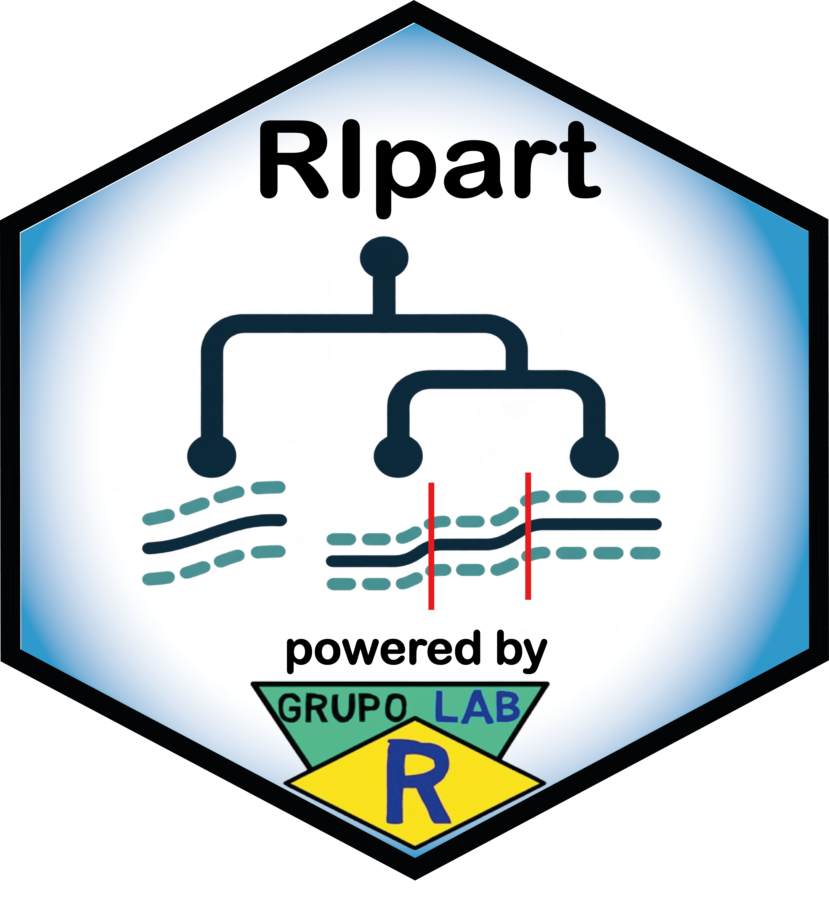

# [𝗥𝗜𝗽𝗮𝗿𝘁](https://github.com/labrgrupo/RIpart)

[Installation](#2-requirements-and-installation) · [Statistical methods](#7-statistical-methods) · [Saved outputs](#12-saved-outputs)




**RIpart — Reference Interval Partitioning** is an R Shiny application for proposing **age and sex partitions for laboratory reference intervals**. It combines four complementary statistical approaches with repeated subsampling, standardized differences and minimum sample size criteria to identify groups for subsequent reference interval estimation and validation.

The analytical framework integrates **regression trees**, **robust profile segmentation through dynamic programming**, **changes in mean and variance**, and **changes in distribution tails**. Candidate divisions are assessed through agreement between methods, selection frequency across subsamples and the magnitude of the difference between neighbouring groups.

RIpart supports **analyte-specific analyses** through user-selected result, age and optional binary group columns. When separation by sex or another group is retained, age is reassessed within each group to identify group-specific cut points.

Results include a **final partition table**, an **`rpart.plot` decision tree**, scatterplots with empirical **P50, P10 and P90 profiles**, and detailed tables documenting the evidence behind each proposed division. A standalone **HTML report**, **CSV tables** and **PNG figures at 600 DPI** are saved automatically.

The interface and report are available in **English and Portuguese**, while text inside figures remains in **English**.

**Developed by Alan Carvalho Dias · Powered by LabR Group**

<br clear="right"/>

**Repository contents**

- **`README.md`** — installation instructions, analytical methods, configuration parameters and interpretation of results.
- **`RIpart_logo.png`** — RIpart logo with a transparent background.

The application is distributed as **`app.R`**. Place this script in the application folder to run RIpart.

## 1. Main features

- Four complementary methods for detecting distributional changes.
- Repeated subsampling to assess support for candidate age cuts and group separation.
- Separate age analyses within groups when separation is retained.
- A final partition table combining age and group boundaries.
- A decision tree rendered with `rpart.plot` from the retained partition.
- Scatterplots with empirical P50, P10 and P90 profiles.
- Tables showing candidate cuts, method support, standardized differences and analysis settings.
- A standalone HTML report with embedded figures.
- Automatic export of CSV tables and PNG figures at 600 DPI.
- English and Portuguese interface and report text.
- English text inside all figures.
- A responsive header with an embedded transparent logo.
- A configured upper limit of 30 final age-by-group cells.

## 2. Requirements and installation

Install R 4.1 or later and versions of the required packages compatible with your R installation. RStudio can be used to run the application.

```r
install.packages(c(
  "shiny",
  "shinythemes",
  "kableExtra",
  "readxl",
  "rpart",
  "rpart.plot",
  "base64enc"
))
```

The startup code checks these packages and attempts to install any that are missing. Package installation requires internet access and permission to write to an R package library.

Choose an application folder with write access so that reports, tables, figures and settings can be saved.

## 3. Run the application

Place `app.R` in the application folder. Open it in RStudio and select **Run App**, or run the following command from that folder.

```r
shiny::runApp()
```

An explicit application folder can also be supplied.

```r
shiny::runApp("path/to/RIpart")
```

Use the links in the header to select **English** or **Português**. The URL query parameters `?lang=en` and `?lang=pt` also select the interface language.

The application logo and demonstration datasets are embedded in `app.R`. The repository image `RIpart_logo.png` is used to display the logo in this README.

## 4. Input data

Import a `.csv`, `.txt`, `.xls` or `.xlsx` file with a header row and one laboratory result per row. Map the columns in the **Configuration** tab.

| Column | Requirement | Meaning |
| --- | --- | --- |
| Age | Required | Numerical age in the selected unit |
| Result | Required | Numerical result for the analyte being evaluated |
| Sex or group | Optional | Two levels for the group comparison |

### 4.1. Example file structure

```csv
Age,Sex,Result
24,F,4.65
31,M,5.12
46,F,4.48
58,M,4.91
```

These rows illustrate the file structure. An analysis requires at least three times the configured minimum group size in valid records before optional outlier removal. With the default minimum of 120, the initial requirement is 360 valid records.

### 4.2. Age units

Select **years**, **months** or **days** according to the values supplied in the age column. The unit selection labels and interprets those values.

Proposed cut points fall on the integer age grid used by the analysis. When the age range is large, the script combines consecutive integer ages into wider bins.

### 4.3. Sex or another binary group

For sex analysis, map the female and male codes in the configuration.

For another binary grouping variable, use its two levels. Select all levels to evaluate their separation. Selecting a single level restricts the age analysis to that level.

### 4.4. Data preparation

Use a dataset prepared for the intended reference population.

Rows with missing required values or unparseable numerical values are excluded. Censored strings such as `<5` are treated as missing numerical results.

The selected transformation and outlier settings are applied before the partitioning analyses. Review the retained sample size after these steps.

## 5. Configure and run an analysis

1. Upload a file or load an embedded demonstration dataset.
2. Select the result, age and optional sex or group columns.
3. Confirm the age unit and the levels to include.
4. Select the detection methods.
5. Review the minimum group size, tolerance, transformation, outlier removal and number of subsamples.
6. Select **Run analysis**.
7. Review Table 1, the final partition and the detailed evidence in the age and group tabs.

### 5.1. Demonstration datasets

The application includes two demonstration options.

| Dataset | Contents |
| --- | --- |
| Simulated data | 8,000 results with age-dependent changes and a group effect in selected ages |
| `livertests` | 612 records with age, sex and eight liver analytes, embedded from the reflimR/VeRIf example dataset |

### 5.2. Application tabs

| Tab | Purpose |
| --- | --- |
| Configuration | Import data, map columns and select analysis parameters |
| Proposed partition | Review the summary, final groups, decision tree, scatterplots and calculation record |
| Age consensus | Examine pooled and group-specific age-cut evidence |
| Sex consensus | Examine support for separation between the two group levels |
| About | Read the methodological description and references |

## 6. Default parameters

| Setting | Default | Effect |
| --- | --- | --- |
| Active methods | All four | Methods contributing to the consensus |
| Minimum results per proposed group | 120 | Sample size criterion for retaining a division |
| Standardized difference tolerance | 0.375 | Minimum difference required by the relevance filter |
| Subsampling repetitions | 100 | Repetitions used to measure support |
| Result transformation | Automatic | Uses natural logarithms for positive data when absolute Bowley skewness decreases by at least 0.05 |
| Outlier removal | Tukey 3 × IQR | Excludes values outside the pooled fences on the analysis scale |
| Method support threshold | 60% | Required subsampling frequency for a method to support a candidate |
| Final group cap | 30 | Configured upper limit for the combined age-by-group proposal |

### 6.1. Transformation

The interface offers automatic transformation, forced natural logarithms and the original scale.

Automatic transformation uses natural logarithms when all included results are positive and the absolute Bowley skewness decreases by at least 0.05.

Forced logarithmic transformation requires positive results.

### 6.2. Outlier removal

The available options are Tukey 3 × IQR, Tukey 6 × IQR and retention of all results.

The selected fences are applied on the analysis scale.

```text
Lower fence = Q1 − k × IQR
Upper fence = Q3 + k × IQR
IQR = Q3 − Q1
```

### 6.3. Tolerance

The default tolerance of 0.375 is an exploratory setting.

Evaluate the practical and clinical effect of the proposed partitions on the resulting reference limits.

## 7. Statistical methods

| Method | Implementation | Distributional feature |
| --- | --- | --- |
| Regression tree | `rpart`, with `cp = 0.01` | Changes in the mean |
| Robust profile segmentation | Dynamic programming implemented in `app.R` | Changes in the age profiles of P50, P10 and P90 |
| Change in mean and variance | Binary segmentation with Gaussian likelihood and a BIC-type penalty | Changes in location and dispersion |
| Change in the tails | Binary segmentation of tail-category counts with a BIC-type penalty | Changes in proportions below pooled P10 and above pooled P90 |

### 7.1. Regression tree

The regression tree evaluates splits that reduce variation in the result variable.

The minimum group size constrains the candidate divisions. The script uses `rpart` for this method.

### 7.2. Robust profile segmentation

Dynamic programming finds a best-fitting segmentation of the robust age profiles for each evaluated number of cuts.

Among the evaluated solutions, RIpart selects the solution with the largest number of cuts whose adjacent groups meet the tolerance criterion.

### 7.3. Change in mean and variance

Binary segmentation evaluates changes in location and dispersion using Gaussian likelihood and a BIC-type penalty.

The implementation uses clipped standardized values in its likelihood calculations.

### 7.4. Change in the tails

The tail method evaluates changes in the proportions of results below the pooled P10 and above the pooled P90.

Values equal to these thresholds remain in the central category.

## 8. Consensus and final partition

### 8.1. Repeated subsampling

The pooled age analysis proposes candidate cut points.

Each active method is rerun on random subsamples drawn without replacement. Each subsample contains up to half the results, capped at 50,000 records.

For age candidates, support is evaluated within a window around the proposed position. The window is approximately 3% of the age-grid length, with a minimum of one bin.

### 8.2. Agreement between methods

A method supports a candidate when its selection frequency reaches 60%.

| Active methods | Required supporting methods |
| --- | --- |
| Four | At least two |
| Three | At least two |
| Two | Both |
| One | The active method |

A retained division must also meet the minimum sample size and standardized difference criteria.

Adjacent age bands are merged when these conditions fail.

### 8.3. Separation by sex or group

Within each pooled age band, the group analysis evaluates whether the two levels should be separated.

Consecutive age bands with retained group separation form regions in which age is reassessed within each group. This allows the final proposal to include group-specific age boundaries.

### 8.4. Final groups

The final table combines shared and group-specific boundaries.

The configured upper limit is 30 final groups. When this limit is exceeded, group-specific cuts with the smallest effects are removed first.

## 9. Standardized difference

RIpart uses the largest absolute difference among P50, P10 and P90, divided by a pooled robust standard deviation.

```text
s_pool = sqrt(
  (n_A × s_A² + n_B × s_B²) / (n_A + n_B)
)

D = max(
  |P50_A − P50_B|,
  |P10_A − P10_B|,
  |P90_A − P90_B|
) / s_pool
```

Here, `s_A` and `s_B` are the group MAD values on the standard deviation scale.

Computation follows the selected analysis scale, including natural logarithms when applied. The relevance filter compares `D` with the configured tolerance.

When the pooled dispersion is zero or undefined, the standardized difference is reported as non-estimable.

## 10. Interpret the results

| Classification | Meaning |
| --- | --- |
| Confirmed and relevant | Sufficient method support, adequate group sizes and a difference meeting the tolerance |
| Confirmed, not relevant | Sufficient support with a difference below the tolerance |
| Indicative | Some method support, below the required consensus |
| Weak signal | At least two methods reach 30% to below 60% support, outside windows represented by stronger candidates |
| Insufficient n | At least one group fails the minimum size criterion |
| Non-estimable difference | The dispersion needed to standardize the comparison is zero or undefined |

### 10.1. Analysis summary

**Table 1** combines the analyte, retained sample size, analysis scale, execution time and overall partition outcome.

The outcome text describes the retained shared age cuts, group separation and group-specific age cuts. Gradual-trend messages are included when the corresponding conditions are met.

### 10.2. Final partition

**Table 2** gives the final proposed age-by-group cells.

Subsequent tables explain candidate cuts, group comparisons, method support, calculation details and settings. Numbering follows the outputs available in the current run.

### 10.3. Gradual trends

Gradual-trend messages identify patterns for which continuous age-specific reference limits may deserve evaluation.

Review these messages together with the empirical profiles, the retained boundaries and their effect on the intended reference limits.

## 11. Tables and figures

### 11.1. Final partition table

Each final group includes its age range, group label, sample size, median, P10, P90 and robust dispersion.

These percentiles describe the results within each proposed cell. Estimate and validate the intended reference interval separately for each retained cell.

### 11.2. Decision tree

The decision tree is rendered with `rpart.plot` from the final retained partition.

Its nodes display means, counts and percentages. The tree represents the same rules used by the final partition table.

### 11.3. Scatterplots and percentile profiles

Scatterplots show a sample of the observations and empirical percentile profiles computed in consecutive age blocks.

- **P50** uses a solid line.
- **P10 and P90** use dashed lines.
- Retained boundaries and shaded regions indicate the corresponding age and group decisions.

The profiles use empirical percentiles calculated from the data.

### 11.4. Stability plots

Age stability plots show how frequently each method supports a cut near each age.

Group support plots show how frequently each method supports separation between the two levels within each age band.

The dashed threshold line indicates the required support frequency.

### 11.5. Group differences and uncertainty

Group-effect plots compare standardized differences across age bands. They appear when at least two age bands have estimable differences.

The group-effect table and plot use descriptive 90% bootstrap intervals based on 200 within-group resamples, preserving the observed group sizes.

Candidate-cut position percentiles summarize the distribution of detected cut locations across subsamples.

### 11.6. Language and formatting

All HTML tables use `kableExtra::kbl()`.

Interface text, table labels, figure captions and report explanations follow the selected language. Text inside figures remains in English.

## 12. Saved outputs

After each successful analysis, RIpart writes the settings, report, tables, data used and figures under the application working directory.

| Location | Contents |
| --- | --- |
| `Outputs/saved_params.Rds` | Saved input selections and analysis settings |
| `Outputs/Report_HTML/` | Standalone HTML report with embedded figures and logo |
| `Outputs/Spreadsheets/` | Numbered CSV tables and the records used in the analysis |
| `Outputs/Figures/` | Numbered PNG figures at 600 DPI |

### 12.1. Save everything

Select **Save everything** to export the current analysis again.

Before an analysis, this command saves the settings.

Figures are exported automatically to `Outputs/Figures`.

### 12.2. CSV formatting

CSV formatting follows the interface language.

| Language | Column separator | Decimal separator |
| --- | --- | --- |
| English | Comma | Point |
| Portuguese | Semicolon | Comma |

### 12.3. Preserve analysis runs

Preserve a copy of the output folder for each run that needs to be retained.

Repeating an analysis with the same analyte name and output numbering can overwrite matching files.

For reproducibility, retain the input dataset, `app.R` version, saved settings and exported results.

## 13. Troubleshooting

| Problem | Action |
| --- | --- |
| A required package cannot be loaded | Install the listed packages and check access to the R package library |
| Too few valid records | Check missing values, column mapping, group restrictions and the minimum group size |
| Logarithmic transformation fails | Check for zero or negative results and choose a compatible analysis scale |
| Sex comparison is unavailable | Confirm that the included group variable has exactly two levels and that all levels are selected |
| Output saving fails | Run the app from a folder with write permission and check available disk space |
| An expected partition is absent | Review method support, minimum sample sizes, standardized differences and the group-cap removal column |
| Runtime is long | Review dataset size, active methods and the number of subsampling repetitions |

## 14. Authorship and license

**Developed by Alan Carvalho Dias**

**Powered by LabR Group**

RIpart declares the **GNU General Public License v3.0 — GPL-3.0** in its application footer.
